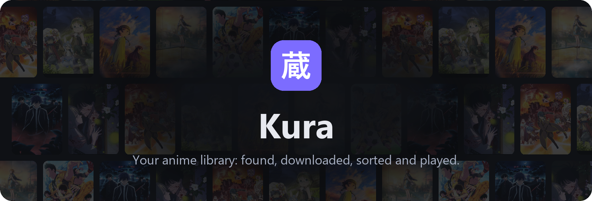
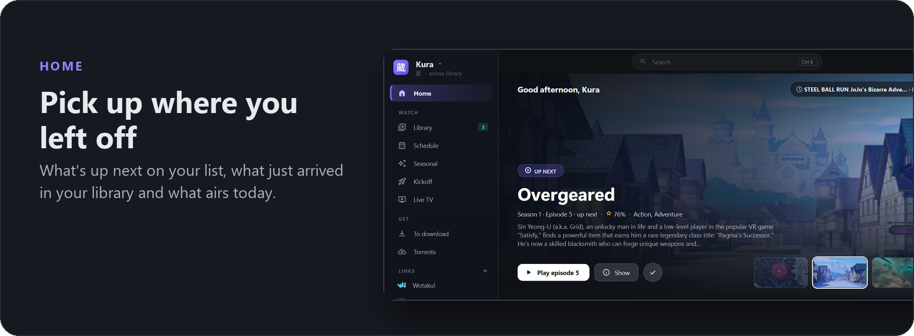
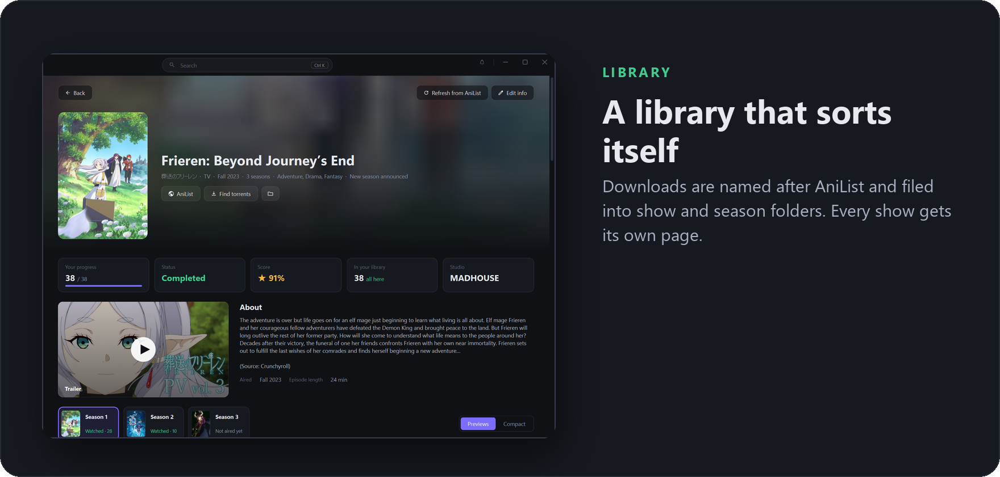
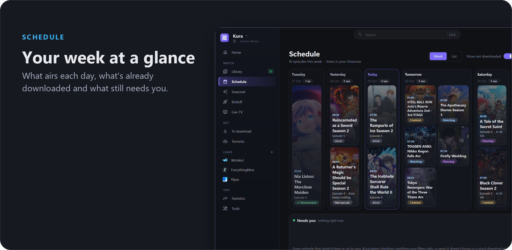
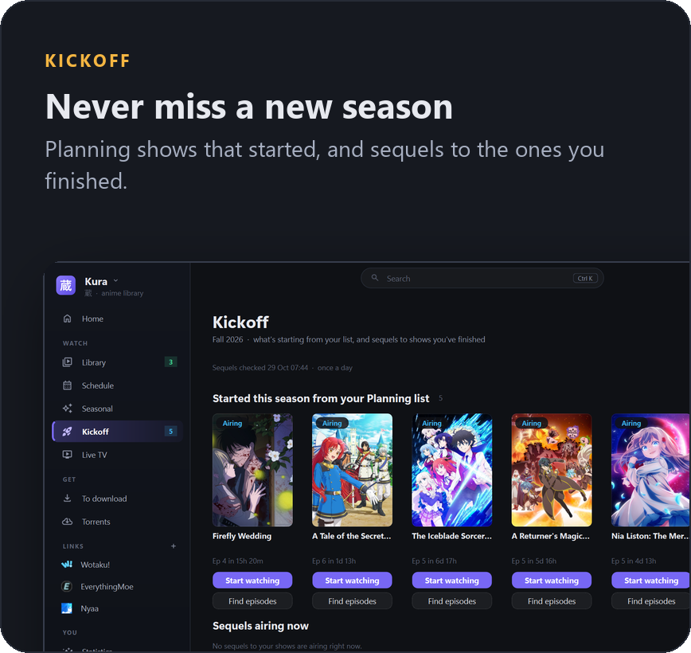
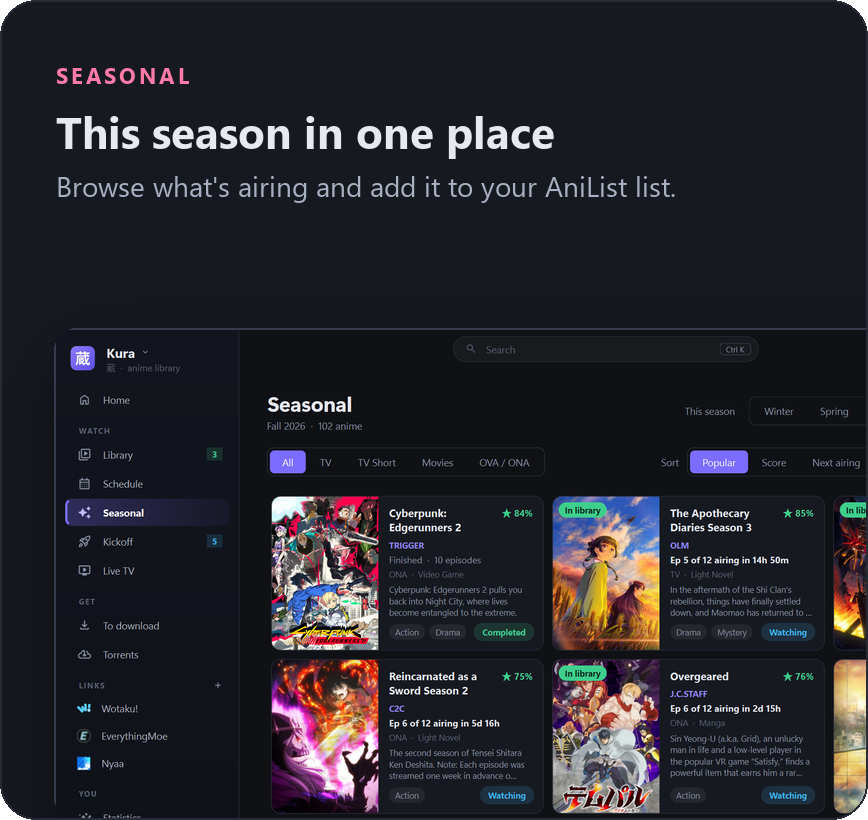

  

  
  
  

  <a href="../../releases/latest"><b>Download</b></a> ·
  <a href="#features"><b>Features</b></a> ·
  <a href="#run-from-source"><b>Run from source</b></a>

Kura is a Windows desktop app for a self-hosted anime library. It finds new episodes, has qBittorrent download them,
sorts them into a tidy library (show and season folders, AniList names, folder icons), keeps your AniList list in sync,
and plays everything in its own player. Jellyfin can stream the same library.

## Features

  
  

### Also in Kura

- **Downloads on their own**: new episodes of the shows you're watching are picked from release feeds by your own
  filters and sent to qBittorrent; search several sites at once for anything missing.
- **The organizer**: finished downloads are renamed after AniList and filed into show and season folders, with
  folder icons. It also runs on its own from qBittorrent (`pyw anime_organizer.py "%F"`).
- **A player made for anime**: mpv inside, skip openings, endings and recaps, subtitles from several sources,
  optional picture enhancement (Anime4K, FSRCNNX, ArtCNN), screenshots and clips, Discord status.
- **Live TV**: channels made from your own library, with a guide, so there's always something on.
- **Statistics and Wrapped**: what you watched, when, and a year in review.
- **Looks after itself**: backups of your data, a library health check, controller support and updates from inside
  the app.

## Install

Download the newest `Kura-x.y.z.zip` and `Kura-runtime-*.zip` from [Releases](../../releases), unzip both into one
folder (the runtime zip into a `kura_runtime` subfolder) and run `Kura.exe`. After that, Kura updates itself:
Settings → App → Updates.

Your settings, sign-ins and caches are kept next to `Kura.exe` and are never part of a release.

## Run from source

Windows 10/11, Python 3.12+.

    pip install PySide6 anitopy pillow mpv pefile winrt-Windows.Media.Ocr winrt-Windows.Graphics.Imaging winrt-Windows.Storage.Streams winrt-Windows.Globalization winrt-Windows.Foundation.Collections
    pythonw kura.pyw

The built-in player needs `libmpv-2.dll` in an `mpv` folder next to `kura.pyw` (from an mpv Windows build, e.g.
[shinchiro's](https://github.com/shinchiro/mpv-winbuild-cmake/releases), the `mpv-dev` archive).

`anime_organizer.py` also works on its own (qBittorrent's "run on finish": `pyw anime_organizer.py "%F"`).

## Build and release

    pip install pyinstaller
    python build_exe.py                          # Kura.exe + kura_runtime next to the scripts
    python release.py 1.1.0 --notes "What's new"  # build, package, tag, publish a GitHub release (needs gh)

`release.py` uploads the big runtime only when it changed since the last release; the in-app updater downloads only
what's different, checks every file, backs up your data, then restarts Kura on the new version.

## License

Kura is free software under the **GNU General Public License v3.0**: see [LICENSE](LICENSE). You can use, study,
share and change it; if you share a changed version, it has to stay under the GPL with its source available.

The release bundles other projects under their own licenses: mpv / libmpv and FFmpeg (GPL / LGPL), Qt for Python
(PySide6, LGPL v3, kept as separate replaceable libraries in `kura_runtime`) and yt-dlp (Unlicense).

Screenshots show a demo AniList list. Anime titles and artwork belong to their respective owners.
